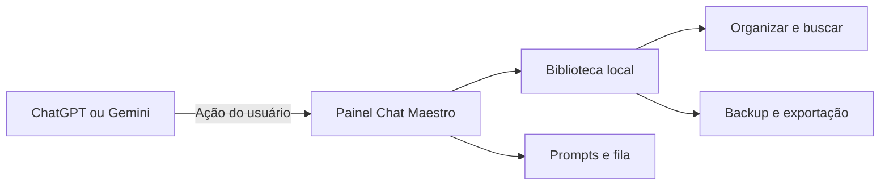

<p align="center">
  
</p>

<h1 align="center">Chat Maestro</h1>

<p align="center">
  <strong>Suas conversas com IA merecem mais do que uma barra lateral.</strong>
</p>

<p align="center">
  Organize seu histórico, encontre o que importa e prepare seus próximos prompts.<br>
  Um espaço de trabalho leve para <strong>ChatGPT</strong> e <strong>Gemini</strong>, direto no Chrome.
</p>

<p align="center">
  <a href="#comece-pelo-chrome">Começar</a> ·
  <a href="#o-que-você-pode-fazer-hoje">Funcionalidades</a> ·
  <a href="#para-onde-vamos">Próximos passos</a> ·
  <a href="#construa-com-a-gente">Participar</a>
</p>

<p align="center">
  
  
  
  <a href="https://github.com/IAPro-Community/chat-maestro/actions/workflows/ci.yml"></a>
</p>

> **Prévia para desenvolvimento · v0.4.1.** A base já inclui biblioteca, organização local e fila de mensagens. A integração visual com sessões autenticadas de ChatGPT e Gemini ainda precisa de homologação. Não há publicação na Chrome Web Store nesta fase.

## O problema não é conversar com IA. É encontrar a conversa depois.

Você começa um chat para resolver uma dúvida. Em seguida, abre outro para trabalhar, outro para estudar, outro para testar uma ideia. Sem perceber, o histórico virou uma lista enorme de assuntos misturados.

O Chat Maestro nasceu para resolver esse problema cotidiano: **dar uma casa para as conversas úteis, facilitar a limpeza do que perdeu relevância e tornar prompts recorrentes mais fáceis de usar** — sem pedir que você abandone seu assistente favorito.

| Quando tudo fica na barra lateral | Com o Chat Maestro |
| --- | --- |
| É difícil reencontrar uma conversa importante | Biblioteca com busca, filtros e favoritos |
| Projetos e assuntos ficam misturados | Pastas e regras de organização |
| Conversas antigas acumulam sem revisão | Sugestões de limpeza e arquivamento **local** com proteção |
| Você reescreve o mesmo pedido toda semana | Templates de prompts com variáveis |
| Vários prompts precisam ser enviados em sequência | Fila editável por conversa, com preparação e confirmação manual |
| É difícil levar a organização para outra instalação | Exportação e backup da biblioteca |

## O que você pode fazer hoje

### 01 · Sua biblioteca, no seu ritmo

Salve a conversa aberta, capture links **visíveis** da barra lateral sob demanda, favorite, mova para pastas e filtre por ChatGPT ou Gemini. Exporte uma seleção em **JSON, Markdown ou TXT**.

A biblioteca é da extensão: ela **não reorganiza automaticamente a barra lateral da sua conta**.

### 02 · Limpeza sem sustos

Crie regras para separar assuntos e revisar conversas antigas. O organizador utiliza datas de atividade confiáveis, respeita itens protegidos e permite visualizar candidatos antes de aplicar mudanças. A rotina diária é opcional e começa desligada.

**Arquivar aqui significa arquivar na biblioteca local.** Nenhuma conversa é apagada ou arquivada na conta ChatGPT ou Gemini.

### 03 · Prompts que você realmente reutiliza

Salve modelos com variáveis, edite-os e prepare o texto para copiar ou inserir no compositor da conversa aberta. A inserção depende da interface de cada plataforma e nunca dispara o envio por conta própria.

### 04 · Ideias em fila, sem perder o controle

Monte uma fila de até **30 mensagens por conversa**, reordene, edite e prepare a próxima no campo de entrada. O Maestro confere o destino e evita sobrescrever rascunhos existentes.

O envio ainda é **manual**: depois de enviar, confirme a etapa no painel para liberar a próxima mensagem.

### Onde funciona?

| Capacidade | ChatGPT | Gemini |
| --- | --- | --- |
| Biblioteca por título e link | Disponível | Disponível |
| Captura pontual da barra lateral | Dependente da interface | Dependente da interface |
| Pastas, favoritos, busca e limpeza local | Disponível | Disponível |
| Templates e fila de prompts | Disponível | Disponível |
| Inserção no compositor | Experimental | Experimental |
| Importação de mensagens do arquivo `conversations.json` | Parcial, somente texto | Ainda não disponível |
| Arquivamento direto na conta | Não disponível | Não disponível |
| Envio automático da fila | Não disponível | Não disponível |

> Capturas de links não fornecem necessariamente a data real da última atividade. O Maestro não inventa essa informação para justificar uma limpeza automática.

## Veja como o fluxo funciona



**Sem backend próprio, sem telemetria, sem login adicional.** Os dados ficam no armazenamento da extensão no seu navegador. Operações sobre a página exigem ação explícita; não há captura contínua de conversas em segundo plano.

## Comece pelo Chrome

**[⬇ Baixar Chat Maestro para Chrome (.zip) — prévia de desenvolvimento](https://github.com/IAPro-Community/chat-maestro/releases/download/preview/chat-maestro-preview.zip)**

Sem GitHub Actions, sem criar conta no GitHub e sem instalar Node.js. O botão acima baixa a versão de desenvolvimento publicada no [GitHub Releases](https://github.com/IAPro-Community/chat-maestro/releases/tag/preview) a partir de uma compilação validada pela CI.

1. **Baixe o ZIP** e extraia os arquivos para uma pasta fixa, como `Documentos/Chat-Maestro`.
2. No Chrome, abra `chrome://extensions` e ative **Modo do desenvolvedor**.
3. Clique em **Carregar sem compactação** e selecione a pasta que contém `manifest.json`.
4. Fixe o ícone **Chat Maestro** no menu de extensões e abra o painel lateral.
5. Em **Biblioteca**, clique em **ChatGPT · conectar** ou **Gemini · conectar**, conforme a plataforma. Autorize o acesso aos domínios solicitados pelo Chrome antes de capturar conversas.

> **Prévia:** a versão atual é destinada a testes; a integração visual com sessões autenticadas de ChatGPT e Gemini ainda está em homologação. O download não é uma instalação pela Chrome Web Store. **O ZIP deve ser extraído** antes de carregar a extensão.

**[Guia completo com atualização, backup e resolução de problemas](docs/INSTALACAO.md)**

Para desenvolvedores (Node.js 22+):

```bash
git clone https://github.com/IAPro-Community/chat-maestro.git
cd chat-maestro
npm install
npm run package
```

O build local gera `release/chat-maestro-v<versao>-instalar.zip`. Para usuários finais, use o **download direto** acima.

### Interface revisada na v0.4.1

A navegação permanece visível durante a rolagem; a **Biblioteca** agora mostra conexão por provedor, captura direta e ações de seleção contextual; **Prompts** dá prioridade aos modelos reutilizáveis e mantém fila/editor recolhidos; **Organizar** inicia pela prévia, deixando configurações detalhadas por demanda.

A v0.4.1 remove a dependência de `activeTab` temporário para operar dentro do painel lateral, substituída por permissão opcional e explícita por provedor. **Ainda não é homologação do Chrome autenticado.** Arquivamento continua exclusivamente local e o envio da fila é manual. [Confira a comparação com a extensão original, os limites e os critérios de aceite](docs/UX_REBUILD.md). Imagens de interface geradas anteriormente são conceitos, **não capturas reais** do produto.

## Para onde vamos

A ideia não é acrescentar dezenas de botões. É resolver melhor os poucos problemas que fazem diferença todo dia.

| Etapa | Entrega que buscamos | Critério para considerar pronta |
| --- | --- | --- |
| **Agora · Base 0.4.1** | Biblioteca, pastas, prompts, fila manual e limpeza local | Build e testes automatizados; homologação de navegador ainda aberta |
| **Próximo · Confiabilidade** | Testes reais em ChatGPT/Gemini, isolamento por conta, melhores diagnósticos | Nenhuma ação executada na conversa ou conta errada |
| **Depois · Histórico em escala** | Busca indexada, paginação e importação mais robusta | Milhares de conversas sem travar a interface |
| **Em estudo · Automação assistida** | Arquivamento na conta e envio sequencial opt-in | Evidência E2E, confirmação de cada ação, pausa e recuperação segura |

O avanço é guiado por **problemas observados, testes reproduzíveis e compatibilidade**. Se uma automação não puder confirmar o que fez, ela não será anunciada como pronta.

Acompanhe o [roadmap detalhado](docs/ROADMAP.md), o [histórico de versões](CHANGELOG.md) e a [pesquisa de funcionalidades](docs/PESQUISA_FUNCIONALIDADES.md).

A identidade oficial do Chat Maestro combina **a mão segurando a batuta de regência, o rosto em forma de conversa e a gravata-borboleta**, sem estrela ou elementos de magia. Os ícones do navegador e o [banner oficial](assets/brand/readme-banner.png) são derivados da mesma [fonte gráfica](assets/brand/icon-source.png). Veja as [regras de marca e de regeneração](docs/BRAND_IDENTITY.md).

## Pequeno por escolha. Preparado para crescer.

O Chat Maestro é um projeto **Chrome Manifest V3, TypeScript strict e IndexedDB**, com uma interface de painel lateral e sem dependências de runtime. Regras de negócio, persistência, integração com a página e telas têm responsabilidades separadas.

```text
src/
  domain/       Regras, modelos, importação e organização
  platform/     IndexedDB, backups e integração opt-in
  ui/           Biblioteca, Organizar, Prompts e Dados
  worker.ts     Eventos e agendamento local opcional
tests/          Contratos e regressão
docs/           Decisões, pesquisa, roadmap e homologação
```

**Princípio de produto:** uma funcionalidade só entra no núcleo se for útil, segura, testável e sustentável. Não é necessário um servidor, um framework novo ou uma assinatura para cada melhoria.

Para trabalhar no código:

```bash
npm run typecheck
npm test
npm run build
```

Consulte a [arquitetura](docs/ARCHITECTURE.md), as [regras de engenharia](AGENTS.md) e o [checklist de testes manuais](docs/TESTES_MANUAIS.md). **Testes automatizados não substituem a validação no Chrome autenticado.**

## Privacidade não é recurso premium

- **Seus dados ficam locais.** Conversas importadas, pastas e filas são armazenadas no navegador.
- **Sem telemetria ou backend da extensão.** Não é necessário criar conta no Chat Maestro.
- **Sem ações silenciosas.** Acesso à página ocorre sob demanda; envio de prompts e alterações nas contas não são automáticos.
- **Sem promessas enganosas.** O Maestro não desbloqueia assinaturas de ChatGPT, Gemini ou de outras extensões.

**Atenção aos backups:** os arquivos exportados podem conter o conteúdo das suas conversas em texto claro. Guarde-os com o mesmo cuidado que qualquer documento confidencial.

## Construa com a gente

O Chat Maestro é desenvolvido pela **[IAPro Community](https://github.com/IAPro-Community)**. Este repositório é também um convite para acompanhar a evolução de uma ferramenta real: o que já funciona, o que está em teste e o que ainda precisa ser resolvido.

Encontrou um comportamento estranho? [Abra uma issue](https://github.com/IAPro-Community/chat-maestro/issues) com navegador, plataforma, passos para reproduzir e resultado esperado. Tem uma ideia para melhorar o dia a dia? Conte **qual problema ela resolve** antes de propor mais uma tela ou configuração.

Para contribuições no código, leia o [AGENTS.md](AGENTS.md) e rode os testes antes de enviar seu pull request. Antes de ampliar a redistribuição externa, o projeto ainda precisa definir uma licença explícita; código público não significa, por si só, licença open-source.

---

<p align="center">
  <strong>Menos tempo procurando. Mais tempo aproveitando o que você já conversou.</strong><br>
  <sub>Chat Maestro · Um projeto da IAPro Community · Não afiliado à OpenAI ou ao Google.</sub>
</p>
